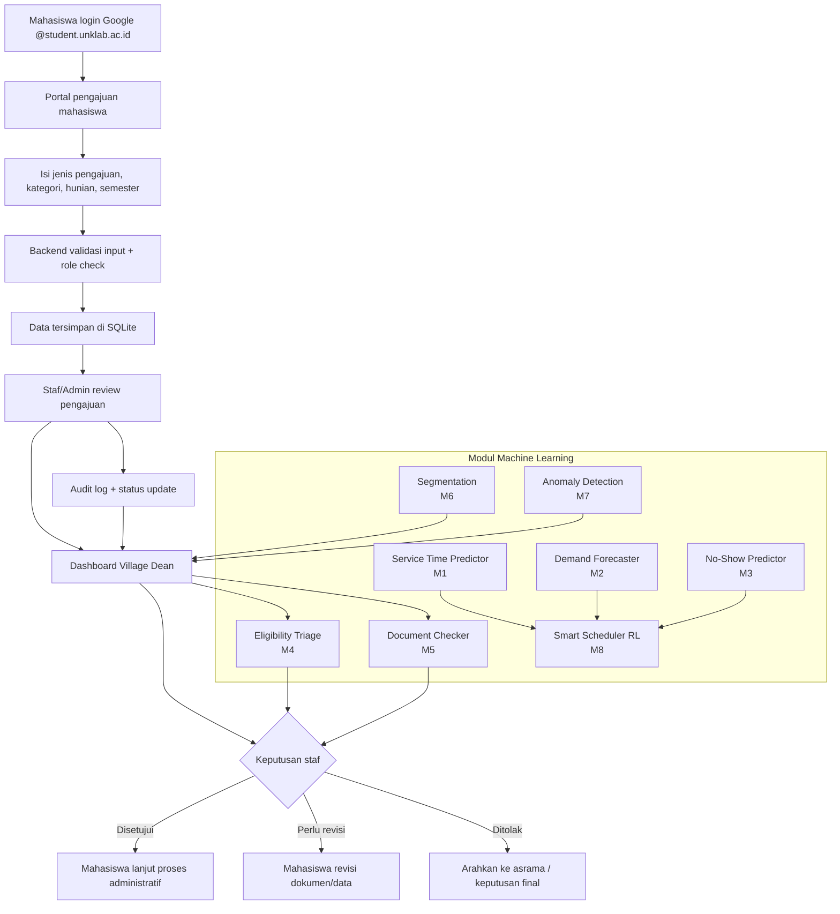

# SIGAP-VD — Village Dean Housing Verification System

Prototype full-stack untuk pendaftaran dasar mahasiswa outsider dan verifikasi administratif kategori hunian Universitas Klabat. Aplikasi memiliki portal mahasiswa dan dashboard staf/admin. Data awal dan dataset ML bersifat sintetis; prediksi hanya rekomendasi petugas, bukan keputusan final.

**Batas penting:** menu **Modul Antrean ML** menyediakan demo sintetis M1–M8 dan simulator FIFO/SPT/Q-learning offline, bukan antrean operasional. Slot, tiket, QR, check-in, notifikasi, dan model yang divalidasi dengan data historis belum tersedia. Model tidak membuktikan pengurangan waktu antrean. Atur kebijakan retensi dan penghapusan dokumen sebelum memproses data pribadi nyata.

Dokumen: [SRS](srs.md) · [Workflow Final Project ML](WORKFLOW.md) · [Custom agent pencatat perubahan](.github/agents/change-logger.agent.md)

## Struktur

- `frontend/`: React, TypeScript, Vite, Tailwind CSS, dan Lucide Icons.
- `backend/`: REST API FastAPI, validasi Pydantic, dan SQLite.
- `ml/`: generator dataset sintetis, evaluasi model scikit-learn, dan artefak model.
- `tools/log_change.py`: menambahkan catatan perubahan ke `srs.md` dengan timestamp WITA.
- `.github/agents/change-logger.agent.md`: petunjuk sub-agent untuk mencatat perubahan.

## Persyaratan

- Python 3.10–3.13
- Node.js 20 atau lebih baru dan npm

## Flowchart sistem dan ML



Penjelasan singkat:
- User login dan submit pengajuan adalah alur sistem utama.
- Model ML berfungsi sebagai bantuan keputusan, bukan pengambil keputusan final.
- Staf tetap memegang keputusan akhir approve, revisi, atau tolak.
- Scheduler RL, demand forecast, dan no-show predictor baru relevan di fase lanjutan, bukan prototype awal.

## 1. Run command copy-paste untuk Windows PowerShell

> Jalankan satu blok per terminal (backend dan frontend dipisahkan). Pastikan folder project sudah berada di root project.

### 1.1 Setup Python dan backend

```powershell
cd "D:\Memories\Task\MachineLearning\FinalProjectVDML\ProjectVDML"
py -3.12 -m venv .venv
.\.venv\Scripts\Activate.ps1
python -m pip install --upgrade pip
python -m pip install -r backend\requirements.txt
if (-not (Test-Path "backend\.env")) { Copy-Item "backend\.env.example" "backend\.env" }
if (-not (Test-Path "frontend\.env.local")) { Copy-Item "frontend\.env.example" "frontend\.env.local" }
notepad backend\.env
notepad frontend\.env.local
```

Isi nilai berikut di file yang terbuka:
- `backend\.env`
  - `GOOGLE_CLIENT_ID=...`
  - `SESSION_SECRET=...` (minimal 32 karakter)
  - `ADMIN_EMAILS=adminVD@unklab.ac.id`
  - `ADMIN_PASSWORD_HASH=...` (hash scrypt; jangan simpan password polos)
  - `SMTP_HOST`, `SMTP_PORT`, `SMTP_USERNAME`, `SMTP_PASSWORD`, dan `SMTP_FROM` untuk mengirim email reset password. Untuk Gmail gunakan App Password, bukan password akun utama.
  - `DOCUMENT_ENCRYPTION_KEY=...` untuk mengenkripsi dokumen yang diunggah; buat dengan `py -c "from cryptography.fernet import Fernet; print(Fernet.generate_key().decode())"`. Simpan dan cadangkan kunci secara aman—dokumen tidak dapat dibuka kembali jika kunci hilang.
  - `COOKIE_SECURE=false` dan `COOKIE_SAMESITE=lax` untuk localhost
  - `FRONTEND_URL=http://localhost:5173`
  - `FRONTEND_ORIGINS=http://localhost:5173,http://127.0.0.1:5173`
  - `DOCUMENT_STORAGE_DIR` bersifat opsional; atur ke direktori privat di luar folder yang disajikan web jika ingin memindahkan penyimpanan dokumen terenkripsi.
- `frontend\.env.local`
  - `VITE_API_URL=` (kosong; API lokal memakai proxy Vite same-origin)
  - `VITE_GOOGLE_CLIENT_ID=...`
  - `VITE_CAMPUS_ORIGIN=...` (opsional, hanya untuk tautan rute manual; default mengarah ke Universitas Klabat)

Mahasiswa membuat akun dengan memverifikasi Google memakai email `8 angka@student.unklab.ac.id` (misalnya `12410292@student.unklab.ac.id`) atau format lama `s` + 8 angka, lalu dapat login dengan Google atau password. Login Google tersedia untuk mahasiswa, staf/admin, dan pemilik kost yang terdaftar. Tautan lupa password berlaku satu jam dan memerlukan konfigurasi SMTP. Admin menggunakan email yang tercantum di `ADMIN_EMAILS`; pemilik kost hanya dapat masuk memakai email Google yang terdaftar pada kost yang disetujui.

Pada halaman login, staf/admin dapat memilih peran **Mahasiswa** untuk membuka portal mahasiswa. Pilihan ini berlaku untuk Google maupun password admin; password admin tetap diverifikasi dan sesi yang dibuat hanya memiliki peran mahasiswa. Pilihan otomatis mempertahankan peran bawaan untuk login password, sedangkan pemilik kost wajib menggunakan Google.

Staf menambahkan kost, email pemilik, dan tautan lokasi melalui menu **Data dan Approval Kost**, lalu menyetujui listing kampus. Hanya listing yang disetujui muncul di formulir mahasiswa. Mahasiswa yang memilih kost harus mengunggah bukti pendaftaran di kost; pemilik masuk dengan Google dan mengonfirmasi status penghuni. Mahasiswa yang tinggal di rumah keluarga/wali wajib mengunggah surat domisili RT/RW atau pemerintah setempat, KTP, dan Kartu Keluarga; Outsider Jauh juga wajib mengunggah KTP dan Kartu Keluarga. Keputusan pengajuan tetap dilakukan staf kampus.

Pada form data mahasiswa dan pemeriksaan, nama hunian serta alamat/area domisili memiliki saran dropdown dari data yang sudah tersimpan. Pilih opsi rumah bila tinggal di rumah, atau ketik pilihan lain. Gunakan area domisili umum, bukan alamat lengkap atau data pribadi nyata.

Di **Pengaturan Sistem**, admin wajib mengisi nama semester, tanggal awal semester, dan tautan lengkap Google Maps kampus. Pengajuan baru hanya dapat dikirim selama lima hari kalender pertama sejak tanggal awal tersebut (WITA). Di luar periode itu, petugas masih dapat memperbarui data yang sudah masuk melalui **Data Mahasiswa**.

Mahasiswa yang tinggal di rumah mengisi tautan Google Maps hunian; mahasiswa kost memakai lokasi dari listing kost yang disetujui. Staf wajib mengisi tautan lokasi ketika menambah/memperbarui data mahasiswa dan listing kost. Sistem membaca koordinat dari tautan lengkap (`@latitude,longitude`, `!3dlatitude!4dlongitude`, atau `q=latitude,longitude`), menghitung jarak garis lurus secara lokal, lalu memeriksa apakah titik berada di batas Sulawesi Utara. Tautan pendek `maps.app.goo.gl` tidak didukung; gunakan tautan penuh yang memuat koordinat. Sistem tidak memakai Google Maps API, tidak mengirim alamat ke layanan geocoding, dan tidak menghitung jarak berkendara. Lokasi di luar provinsi ditandai sebagai anomali untuk tinjauan staf; listing kost dengan anomali lokasi tidak dapat disetujui atau dipilih mahasiswa sampai lokasinya diperbaiki. Model ML dan kelengkapan dokumen memberi rekomendasi saja; keputusan akhir tetap pada petugas.

Geofence Sulawesi Utara menggunakan geometri provinsi dari [geoBoundaries](https://www.geoboundaries.org/), data ADM1 Indonesia dengan shape ID `65028918B26897900130576`, berlisensi CC BY 4.0/ODbL dan disertai atribusi di `backend/north_sulawesi_boundary.json`.

Setelah itu jalankan backend di terminal baru:

```powershell
cd "D:\Memories\Task\MachineLearning\FinalProjectVDML\ProjectVDML"
.\.venv\Scripts\Activate.ps1
cd backend
uvicorn main:app --reload --host 127.0.0.1 --port 8000
```

Backend siap di:
- http://localhost:8000
- http://localhost:8000/docs

### 1.2 Setup frontend

```powershell
cd "D:\Memories\Task\MachineLearning\FinalProjectVDML\ProjectVDML\frontend"
npm install
npm run dev
```

Frontend siap di:
- http://localhost:5173

### 1.3 Verifikasi singkat

Buka browser dan cek:
- http://localhost:5173
- login dengan akun Google mahasiswa `@student.unklab.ac.id`
- login staf/admin dengan email yang terdaftar di `ADMIN_EMAILS`
- cek endpoint docs di http://localhost:8000/docs

## 1. Buat dan evaluasi model ML

Dari direktori root proyek:

```powershell
py -3.12 -m venv .venv
.\.venv\Scripts\python.exe -m pip install -r backend\requirements.txt
.\.venv\Scripts\python.exe ml\train_model.py
```

Training menggunakan dataset sintetis 400 baris di `ml/housing_dataset.csv`, membandingkan Random Forest dan Logistic Regression dengan train/test split, serta menampilkan accuracy, precision, recall, F1-score, dan confusion matrix. Model terbaik berdasarkan macro F1 tersimpan di `ml/artifacts/housing_model.joblib`; metrik perbandingan tersimpan di `ml/artifacts/model_metrics.json`. Backend juga mencoba menjalankan training otomatis bila artefak belum ada.

Jika model gagal dilatih atau dimuat, backend tetap dapat melayani dashboard, data mahasiswa, riwayat, dan pengaturan. Informasi kegagalan ditampilkan di dashboard; analisis ML dinonaktifkan sampai model siap.

### Demo modul antrean (M1–M8)

Setelah login sebagai staf/admin, buka **Simulasi Layanan Awal Semester** dari menu. Pilih tanggal
Senin sebagai awal simulasi lima hari layanan. Simulasi ini dijalankan untuk satu periode awal
semester saja dan tidak mewakili analisis mingguan berulang. Default demo mengasumsikan layanan
Senin–Jumat pukul 08.00–17.00, dua loket ilustratif, dan 80 pendaftar sintetis per hari. Pendaftaran
online nyata dibuka hanya selama lima hari kalender pertama sejak tanggal awal semester yang
dikonfigurasi admin; pembaruan data mahasiswa yang telah terdaftar tetap dapat dilakukan petugas.

Hasil mencakup M1 prediksi durasi vs baseline median, M2 perkiraan beban dari empat periode
sintetis lima hari (divalidasi dengan MAE pada periode sintetis kelima), M3 estimasi no-show,
M4 triase aturan sementara, M5 checklist tanpa unggah, M6 segmen layanan, M7 anomaly flags, serta
M8 perbandingan FIFO/SPT/Q-learning. Seed dapat dipakai untuk mengulang skenario yang sama.
Simulasi berjalan offline pada data buatan dan tidak membuat slot/tiket atau mengubah pengajuan
nyata. Ambang kategori, aturan dokumen, jumlah loket, dan volume perlu diganti setelah kebijakan
serta data resmi dikonfirmasi.

## 2. Konfigurasi autentikasi Google

1. Buat OAuth 2.0 Web client di Google Cloud dan tambahkan origin `http://localhost:5173` ke
   Authorized JavaScript origins. Gunakan Client ID yang sama untuk backend dan frontend.
2. Salin `backend\.env.example` menjadi `backend\.env`, lalu isi:
   - `GOOGLE_CLIENT_ID`: OAuth Web Client ID.
   - `SESSION_SECRET`: nilai acak minimal 32 karakter; buat misalnya dengan
     `py -c "import secrets; print(secrets.token_urlsafe(48))"`.
   - `ADMIN_EMAILS`: alamat admin yang diizinkan, dipisahkan koma.
   - `ADMIN_PASSWORD_HASH`: buat hash scrypt dari folder `backend` dengan
     `py -c "from getpass import getpass; from auth import hash_password; print(hash_password(getpass()))"`
     lalu simpan hasilnya, bukan password polos.
   - Atur `SMTP_HOST`, `SMTP_PORT`, `SMTP_USERNAME`, `SMTP_PASSWORD`, dan `SMTP_FROM`
     agar email reset password dapat dikirim. Gmail memerlukan App Password.
   - `DOCUMENT_ENCRYPTION_KEY`: buat dari root project dengan
     `.\.venv\Scripts\python.exe -c "from cryptography.fernet import Fernet; print(Fernet.generate_key().decode())"`.
     Kunci ini wajib untuk unggah dokumen; simpan cadangan rahasia yang aman dan gunakan kunci yang sama saat aplikasi dijalankan kembali.
3. Salin `frontend\.env.example` menjadi `frontend\.env.local`, lalu isi
   `VITE_GOOGLE_CLIENT_ID` dengan Client ID yang sama dan sesuaikan
   `VITE_CAMPUS_ORIGIN` bila lokasi asal rute berbeda. Integrasi tautan Google Maps tidak
   membutuhkan API key atau billing Routes API.
4. Email mahasiswa harus berformat 8 angka, dengan atau tanpa awalan `s`, di domain
   `@student.unklab.ac.id`; akun dibuat setelah verifikasi Google. Pemilik kost masuk memakai
   Google dengan email yang didaftarkan pada kost berstatus Disetujui. Admin hanya dapat masuk
   dengan alamat di `ADMIN_EMAILS` dan password yang cocok dengan `ADMIN_PASSWORD_HASH`.
5. Untuk produksi gunakan HTTPS, set `COOKIE_SECURE=true`, batasi `FRONTEND_ORIGINS`, dan
   lengkapi enkripsi/retensi/backup serta review privasi sebelum memproses data nyata. Ganti
   password admin demo dengan password unik yang kuat sebelum deployment.

### Melatih model dengan data Village Dean

Letakkan data asli di `ml/villagedean_dataset.csv` dengan minimal kolom:

- `jarak_km`: jarak hunian mahasiswa dari kampus dalam kilometer.
- `kategori_outsider`: nilai `dekat` atau `jauh`.

Dataset harus memuat minimal 20 baris dan kedua kategori. Data dibaca secara anonim: kolom
`id_anonim` dan `nama_kost` tidak digunakan untuk pelatihan. Jalankan pelatihan dari root
proyek:

```powershell
.venv\Scripts\python.exe ml\train_model.py
```

Model baru disimpan di `ml\artifacts\housing_model.joblib` dan hasil evaluasi disimpan di
`ml\artifacts\model_metrics.json`. Restart backend setelah pelatihan agar model baru dimuat.
Jika file `ml/villagedean_dataset.csv` tidak ditemukan, pelatihan menggunakan dataset sintetis
`ml/housing_dataset.csv` yang dibuat otomatis.

## 3. Jalankan backend

Buka dua terminal Command Prompt. Jalankan backend di terminal pertama:

```cmd
cd backend
uvicorn main:app --reload
```

Perintah `uvicorn` menggunakan virtual environment proyek melalui pembungkus `backend\uvicorn.cmd`.

API tersedia di `http://localhost:8000`; dokumentasi interaktif ada di `http://localhost:8000/docs`. Database `backend/housing.db` dan seed mahasiswa/riwayat demonstrasi dibuat otomatis saat startup pertama. CORS diizinkan untuk `http://localhost:5173`.

## 4. Jalankan frontend

Di terminal kedua, jalankan frontend dari folder `backend`:

```cmd
cd backend
npm run dev
```

Script `dev` meneruskan perintah ke frontend. Dependency frontend dipasang satu kali dari folder `frontend` dengan `npm install`. Buka URL yang ditampilkan Vite (default `http://localhost:5173`). Untuk pemeriksaan TypeScript dan production build, jalankan `npm --prefix ..\frontend run build` dari folder `backend`.

Jika menggunakan PowerShell, panggil pembungkus secara eksplisit: `.\uvicorn.cmd main:app --reload` untuk backend dan `npm.cmd run dev` untuk frontend. `npm` tanpa akhiran `.cmd` dapat diblokir oleh Execution Policy PowerShell.

## Endpoint utama

- `GET /api/health`; `POST /api/auth/google`, `GET /api/auth/me`, `POST /api/auth/logout`, `POST /api/auth/password-reset/request`, `POST /api/auth/password-reset`
- `GET/POST /api/kosts`, `PATCH /api/kosts/{id}/approval`; `GET /api/kosts/approved` (mahasiswa); `GET /api/owner/applications`, `PATCH /api/owner/applications/{id}/confirmation`
- `GET /api/applications/me` and `POST /api/applications/with-documents` (mahasiswa); `GET/PATCH /api/applications` (staf/admin)
- `GET /api/dashboard`, `GET/POST/PUT/DELETE /api/students`
- `POST /api/inspections/analyze`, `GET /api/inspections?search=...&status=...`
- `GET/PUT /api/settings`, `GET /api/ml/info`

## Catatan demonstrasi

Model ini dilatih pada data buatan untuk keperluan proyek akademik dan bukan data survei lapangan. Hasil confidence tidak boleh dianggap sebagai kepastian; zona jarak dan ambang confidence hanya menandai data yang memerlukan peninjauan petugas. Data mahasiswa contoh menggunakan nama tampilan dan ID sintetis.

Change log diperbarui melalui custom agent `change-logger` atau manual:

```powershell
py tools\log_change.py --title "Ringkasan perubahan" --type CHANGED --phase 5 --files frontend\src\App.tsx --details "Perubahan yang sudah diverifikasi"
```
