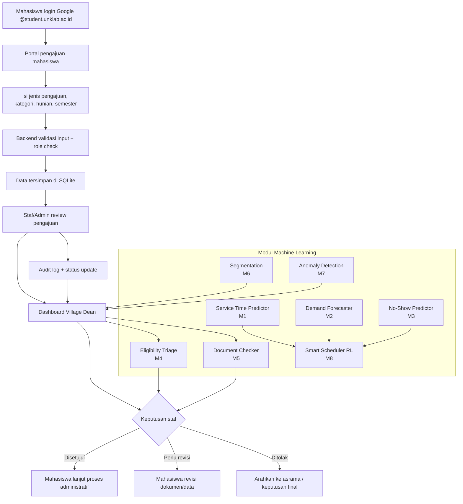

# SIGAP-VD — Village Dean Housing Verification System

Prototype full-stack untuk pendaftaran dasar mahasiswa outsider dan verifikasi administratif kategori hunian Universitas Klabat. Aplikasi memiliki portal mahasiswa dan dashboard staf/admin. Data awal dan dataset ML bersifat sintetis; prediksi hanya rekomendasi petugas, bukan keputusan final.

**Batas penting:** menu **Modul Antrean ML** menyediakan demo sintetis M1–M8 dan simulator FIFO/SPT/Q-learning offline, bukan antrean operasional. Slot, tiket, QR, check-in, notifikasi, dan model yang divalidasi dengan data historis belum tersedia. Model tidak membuktikan pengurangan waktu antrean. Jangan masukkan dokumen domisili, alamat lengkap, NIM, atau data pribadi nyata.

Dokumen: [SRS](srs.md) · [Workflow Final Project ML](WORKFLOW.md) · [Custom agent pencatat perubahan](.github/agents/change-logger.agent.md)

## Struktur

- `frontend/`: React, TypeScript, Vite, Tailwind CSS, dan Lucide Icons.
- `backend/`: REST API FastAPI, validasi Pydantic, dan SQLite.
- `ml/`: generator dataset sintetis, evaluasi model scikit-learn, dan artefak model.
- `tools/log_change.py`: menambahkan catatan perubahan ke `srs.md` dengan timestamp WITA.
- `.github/agents/change-logger.agent.md`: petunjuk sub-agent untuk mencatat perubahan.

## Persyaratan

- Python 3.10–3.13
- Node.js 20 atau lebih baru dan npm

## Flowchart sistem dan ML



Penjelasan singkat:
- User login dan submit pengajuan adalah alur sistem utama.
- Model ML berfungsi sebagai bantuan keputusan, bukan pengambil keputusan final.
- Staf tetap memegang keputusan akhir approve, revisi, atau tolak.
- Scheduler RL, demand forecast, dan no-show predictor baru relevan di fase lanjutan, bukan prototype awal.

## 1. Run command copy-paste untuk Windows PowerShell

> Jalankan satu blok per terminal (backend dan frontend dipisahkan). Pastikan folder project sudah berada di root project.

### 1.1 Setup Python dan backend

```powershell
cd "D:\Memories\Task\MachineLearning\FinalProjectVDML\ProjectVDML"
py -3.12 -m venv .venv
.\.venv\Scripts\Activate.ps1
python -m pip install --upgrade pip
python -m pip install -r backend\requirements.txt
if (-not (Test-Path "backend\.env")) { Copy-Item "backend\.env.example" "backend\.env" }
if (-not (Test-Path "frontend\.env.local")) { Copy-Item "frontend\.env.example" "frontend\.env.local" }
notepad backend\.env
notepad frontend\.env.local
```

Isi nilai berikut di file yang terbuka:
- `backend\.env`
  - `GOOGLE_CLIENT_ID=...`
  - `SESSION_SECRET=...` (minimal 32 karakter)
  - `ADMIN_EMAILS=your.admin@unklab.ac.id`
  - `COOKIE_SECURE=false`
  - `FRONTEND_ORIGINS=http://localhost:5173,http://127.0.0.1:5173`
- `frontend\.env.local`
  - `VITE_API_URL=http://localhost:8000`
  - `VITE_GOOGLE_CLIENT_ID=...`

Di halaman login, masukkan email Google dan pilih **User/Mahasiswa** atau **Admin/Staf**, lalu tekan **Masuk**. Jika Google One Tap tidak muncul, gunakan tombol **Sign in with Google** di bawahnya. Email harus cocok dengan akun Google yang diverifikasi. Mode Admin/Staf hanya diberikan kepada email dalam `ADMIN_EMAILS`; akun admin juga dapat memilih mode User/Mahasiswa untuk membuka portal mahasiswa dengan hak akses mahasiswa.

Pada form data mahasiswa dan pemeriksaan, nama hunian serta alamat/area domisili memiliki saran dropdown dari data yang sudah tersimpan. Pilih opsi rumah bila tinggal di rumah, atau ketik pilihan lain. Gunakan area domisili umum, bukan alamat lengkap atau data pribadi nyata.

Setelah itu jalankan backend di terminal baru:

```powershell
cd "D:\Memories\Task\MachineLearning\FinalProjectVDML\ProjectVDML"
.\.venv\Scripts\Activate.ps1
cd backend
uvicorn main:app --reload --host 0.0.0.0 --port 8000
```

Backend siap di:
- http://localhost:8000
- http://localhost:8000/docs

### 1.2 Setup frontend

```powershell
cd "D:\Memories\Task\MachineLearning\FinalProjectVDML\ProjectVDML\frontend"
npm install
npm run dev
```

Frontend siap di:
- http://localhost:5173

### 1.3 Verifikasi singkat

Buka browser dan cek:
- http://localhost:5173
- login dengan akun Google mahasiswa `@student.unklab.ac.id`
- login staf/admin dengan email yang terdaftar di `ADMIN_EMAILS`
- cek endpoint docs di http://localhost:8000/docs

## 1. Buat dan evaluasi model ML

Dari direktori root proyek:

```powershell
py -3.12 -m venv .venv
.\.venv\Scripts\python.exe -m pip install -r backend\requirements.txt
.\.venv\Scripts\python.exe ml\train_model.py
```

Training menggunakan dataset sintetis 400 baris di `ml/housing_dataset.csv`, membandingkan Random Forest dan Logistic Regression dengan train/test split, serta menampilkan accuracy, precision, recall, F1-score, dan confusion matrix. Model terbaik berdasarkan macro F1 tersimpan di `ml/artifacts/housing_model.joblib`; metrik perbandingan tersimpan di `ml/artifacts/model_metrics.json`. Backend juga mencoba menjalankan training otomatis bila artefak belum ada.

Jika model gagal dilatih atau dimuat, backend tetap dapat melayani dashboard, data mahasiswa, riwayat, dan pengaturan. Informasi kegagalan ditampilkan di dashboard; analisis ML dinonaktifkan sampai model siap.

### Demo modul antrean (M1–M8)

Setelah login sebagai staf/admin, buka **Modul Antrean ML** dari menu. Pilih tanggal Senin
sebagai awal periode, lalu jalankan simulasi satu minggu. Default demo mengasumsikan layanan
Senin–Jumat pukul 08.00–17.00, dua loket ilustratif, dan 80 pendaftar sintetis per hari. Hari/jam
dan periode satu minggu pada awal semester (sebelum pembayaran uang kuliah dan kontrak mata
kuliah) berasal dari informasi awal pengguna; volume dan jumlah loket hanyalah asumsi sementara.

Hasil mencakup M1 prediksi durasi vs baseline median, M2 perkiraan beban dari empat minggu sintetis
(divalidasi dengan MAE pada minggu sintetis kelima), M3 estimasi no-show,
M4 triase aturan sementara, M5 checklist tanpa unggah, M6 segmen layanan, M7 anomaly flags, serta
M8 perbandingan FIFO/SPT/Q-learning. Seed dapat dipakai untuk mengulang skenario yang sama.
Simulasi berjalan offline pada data buatan dan tidak membuat slot/tiket atau mengubah pengajuan
nyata. Ambang kategori, aturan dokumen, jumlah loket, dan volume perlu diganti setelah kebijakan
serta data resmi dikonfirmasi.

## 2. Konfigurasi autentikasi Google

1. Buat OAuth 2.0 Web client di Google Cloud dan tambahkan origin `http://localhost:5173` ke
   Authorized JavaScript origins. Gunakan Client ID yang sama untuk backend dan frontend.
2. Salin `backend\.env.example` menjadi `backend\.env`, lalu isi:
   - `GOOGLE_CLIENT_ID`: OAuth Web Client ID.
   - `SESSION_SECRET`: nilai acak minimal 32 karakter; buat misalnya dengan
     `py -c "import secrets; print(secrets.token_urlsafe(48))"`.
   - `ADMIN_EMAILS`: alamat Google staf yang boleh masuk ke dashboard administrasi, dipisahkan
     koma. Jangan masukkan credential atau rahasia ke Git.
3. Salin `frontend\.env.example` menjadi `frontend\.env.local`, lalu isi
   `VITE_GOOGLE_CLIENT_ID` dengan Client ID yang sama.
4. Akun mahasiswa harus berakhiran `@student.unklab.ac.id`. Peran admin ditentukan backend
   melalui `ADMIN_EMAILS`, bukan pilihan di browser.
5. Untuk produksi gunakan HTTPS, set `COOKIE_SECURE=true`, batasi `FRONTEND_ORIGINS`, dan
   lengkapi enkripsi/retensi/backup serta review privasi sebelum memproses data nyata.

## 3. Jalankan backend

Di Command Prompt, jalankan:

```cmd
cd backend
uvicorn main:app --reload
```

Perintah `uvicorn` menggunakan virtual environment proyek melalui pembungkus `backend\uvicorn.cmd`.

API tersedia di `http://localhost:8000`; dokumentasi interaktif ada di `http://localhost:8000/docs`. Database `backend/housing.db` dan seed mahasiswa/riwayat demonstrasi dibuat otomatis saat startup pertama. CORS diizinkan untuk `http://localhost:5173`.

## 4. Jalankan frontend

Buka terminal baru dari root proyek:

```powershell
cd frontend
npm.cmd install
npm.cmd run dev
```

Buka URL yang ditampilkan Vite (default `http://localhost:5173`). Untuk pemeriksaan TypeScript dan production build, jalankan `npm run build`.

## Endpoint utama

- `GET /api/health`; `POST /api/auth/google`, `GET /api/auth/me`, `POST /api/auth/logout`
- `GET /api/applications/me` and `POST /api/applications` (mahasiswa); `GET/PATCH /api/applications` (staf/admin)
- `GET /api/dashboard`, `GET/POST/PUT/DELETE /api/students`
- `POST /api/inspections/analyze`, `GET /api/inspections?search=...&status=...`
- `GET/PUT /api/settings`, `GET /api/ml/info`

## Catatan demonstrasi

Model ini dilatih pada data buatan untuk keperluan proyek akademik dan bukan data survei lapangan. Hasil confidence tidak boleh dianggap sebagai kepastian; zona jarak dan ambang confidence hanya menandai data yang memerlukan peninjauan petugas. Data mahasiswa contoh menggunakan nama tampilan dan ID sintetis.

Change log diperbarui melalui custom agent `change-logger` atau manual:

```powershell
py tools\log_change.py --title "Ringkasan perubahan" --type CHANGED --phase 5 --files frontend\src\App.tsx --details "Perubahan yang sudah diverifikasi"
```
